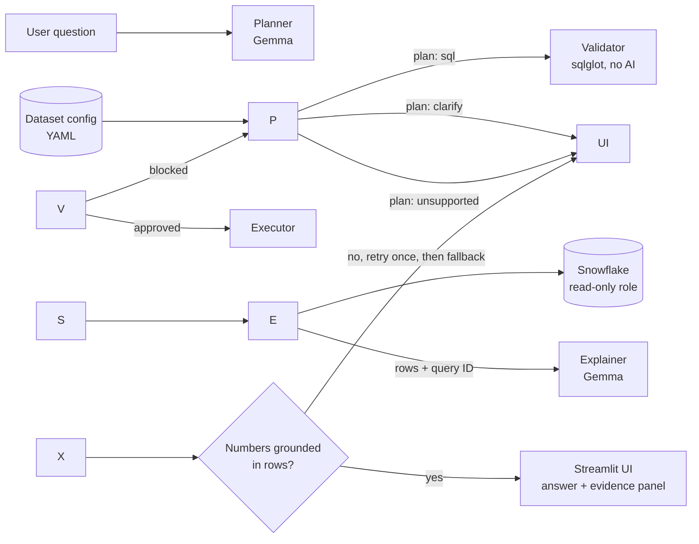

# PS1 — DataMind: Talk to Your Data
# ThreatDesk

**Ask your vulnerability data a question, and see exactly how the answer was computed.**

ThreatDesk is an open-source data agent. You ask a question in plain English about public vulnerability data, for example:

> Which vendors had the most actively exploited critical CVEs this year?

Gemma turns the question into a SQL plan, a deterministic validator checks that the SQL is safe, Snowflake runs it, and Gemma explains the result using only the rows that came back. Every answer comes with the executed query, the result rows, the assumptions made and the Snowflake query ID, so a reader can check the claim instead of trusting it.

Built for the **ZeroDay OSS Hacktoberfest 2026, PS1: DataMind** track.

\---

## Table of contents

1. [Why ThreatDesk](#why-threatdesk)
2. [Features](#features)
3. [How it works](#how-it-works)
4. [Architecture](#architecture)
5. [Project structure](#project-structure)
6. [Prerequisites](#prerequisites)
7. [Setup](#setup)
8. [Configuration](#configuration)
9. [Running ThreatDesk](#running-threatdesk)
10. [Data sources and licences](#data-sources-and-licences)
11. [Safety and guardrails](#safety-and-guardrails)
12. [Handling ambiguous, empty and unsupported questions](#handling-ambiguous-empty-and-unsupported-questions)
13. [Using a different dataset](#using-a-different-dataset)
14. [Evaluation](#evaluation)
15. [Data-change demo](#data-change-demo)
16. [Testing](#testing)
17. [Troubleshooting](#troubleshooting)
18. [Known limitations](#known-limitations)
19. [Technical contribution](#technical-contribution)
20. [Built with AI assistance](#built-with-ai-assistance)
21. [Contributing](#contributing)
22. [Licence](#licence)

\---

## Why ThreatDesk

Vulnerability data is public and large, but answering a practical question usually means writing SQL and joining several feeds by hand. The people who understand the questions best are often not the people who can query the data. General chatbots can describe CVEs fluently, but their numbers cannot be checked.

ThreatDesk takes the opposite approach:

* Answers are **computed from the data at question time**, not recalled by a model.
* Every answer is **traceable** from the claim to the query to the rows.
* The system says so when the data **cannot** answer a question.

## Features

* Plain-English questions over joined vulnerability tables (CVE records, known-exploited catalog, exploitation-probability scores).
* Gemma-generated SQL plans, validated by a deterministic checker before anything runs.
* Snowflake execution under a **read-only role**, with the Snowflake query ID captured for every answer.
* Plain-language explanations grounded in the returned rows, with an automatic check that every number in the explanation appears in the results.
* An evidence panel showing the executed SQL, result rows, tables used, assumptions and runtime.
* Clarifying questions for vague wording, stated defaults for assumptions, honest handling of empty results, and refusal of unsupported or unsafe requests.
* Follow-up questions that keep context from the last few turns.
* Dataset-agnostic design: a YAML config describes the tables, so a second dataset works through configuration, not code changes. <!-- TODO: confirm after testing the second dataset -->
* A reproducible evaluation set with ground truth computed independently in pandas.

## How it works

1. **Ask.** You type a question in the Streamlit app or the command line.
2. **Plan.** Gemma receives the dataset config (tables, columns, descriptions, join keys, notes, examples) and recent conversation. It returns a JSON plan with one of three actions: `sql`, `clarify` or `unsupported`.
3. **Validate.** For `sql` plans, a deterministic validator parses the query and allows only a single `SELECT` over tables and columns listed in the config, with an enforced row limit. Anything else is blocked. If a plan fails validation, Gemma gets the error and one chance to repair it.
4. **Execute.** The validated query runs on Snowflake using a read-only role. The app records the rows, row count, runtime and query ID.
5. **Explain.** Gemma sees only the question, the executed SQL, the assumptions and the capped result rows, and writes a short explanation. A check confirms every number it mentions appears in the rows. If not, it regenerates once and then falls back to a plain description of the result.
6. **Show evidence.** The UI renders the answer, the explanation and the evidence panel.

### Who does what

|Component|Does|Never does|
|-|-|-|
|Gemma|Interprets questions, plans SQL, asks clarifying questions, explains results|Compute numbers, access data, run queries|
|Validator (no AI)|Approves or blocks SQL|Change the meaning of a question|
|Snowflake|Stores data and runs every query|Interpret language|
|UI|Shows the answer and all evidence|Hide the SQL or the rows|

## Architecture



A fuller description of each component is in [`docs/architecture.md`](docs/architecture.md).

## Project structure

```
threatdesk/
├── .env.example          # placeholders for required environment variables
├── LICENSE
├── README.md
├── requirements.txt      # pinned dependencies
├── app/
│   ├── ui.py             # Streamlit interface and evidence panel
│   ├── cli.py            # terminal runner
│   ├── config.py         # environment and YAML config loading
│   ├── planner.py        # Gemma call, JSON plan
│   ├── validator.py      # SQL safety checks
│   ├── executor.py       # Snowflake execution, query ID capture
│   ├── explainer.py      # Gemma explanation and number grounding check
│   ├── session.py        # follow-up context
│   └── schemas.py        # Pydantic models
├── configs/
│   ├── threat\_intel.yaml     # main dataset config
│   └── second\_dataset.yaml   # second dataset (config-only proof)
├── scripts/
│   ├── check\_env.py          # connectivity check for Gemma and Snowflake
│   ├── setup\_snowflake.sql   # database, warehouse, read-only role
│   ├── load\_data.py          # downloads and loads the source data
│   └── demo\_change.py        # data-change demo with undo
├── eval/
│   ├── questions.yaml        # evaluation questions (dev and held-out)
│   ├── ground\_truth.py       # expected answers computed in pandas
│   ├── run\_eval.py           # runs the pipeline and writes results
│   └── results/
├── tests/
├── docs/
│   ├── architecture.md
│   ├── DATA\_SOURCES.md
│   └── evidence/             # Snowflake query history, demo notes
└── data/                     # downloaded raw files (git-ignored)
```

## Prerequisites

* Python 3.11 or newer (tested on: TODO).
* A **Snowflake** account. A free trial is enough. Check Snowflake's current sign-up page for credits and duration, because they can change.
* A **Google AI Studio API key** for Gemma through the Gemini API. Check the current free-tier limits in AI Studio.
* Optional: a free **NVD API key** to raise rate limits when downloading CVE data.
* Internet access during setup and data loading.

Tested environment: TODO (operating system, Python version, Snowflake region, hardware).

## Setup

### 1\. Clone and create an environment

```bash
git clone <repository-url>
cd threatdesk
python -m venv .venv
source .venv/bin/activate        # Windows: .venv\\Scripts\\activate
pip install -r requirements.txt
```

### 2\. Create your `.env`

```bash
cp .env.example .env
```

Fill in the values in `.env` (see [Configuration](#configuration)). Never commit this file. It is listed in `.gitignore`.

### 3\. Check connectivity

```bash
python scripts/check\_env.py
```

This reports whether each required variable is set (never printing the values), makes one small Gemma call, and connects to Snowflake. Fix any failure before moving on.

### 4\. Set up Snowflake

Run `scripts/setup\_snowflake.sql` in your Snowflake account (for example in a worksheet, or through the Snowflake CLI). It creates:

* a database and schema,
* the smallest warehouse with a short auto-suspend,
* a read-only role used by the app at question time,
* the grants needed by the loader.

### 5\. Load the data

```bash
python scripts/load\_data.py
```

The loader downloads the source files at run time into `data/` (git-ignored) and loads them into Snowflake. It prints row counts per table. Raw data is not stored in this repository.

## Configuration

All secrets and settings come from environment variables, loaded from `.env`.

|Variable|Required|Purpose|
|-|-|-|
|`GEMINI\_API\_KEY`|Yes|Google AI Studio key for Gemma|
|`GEMMA\_MODEL`|Yes|Primary Gemma model ID (default `gemma-4-26b-a4b-it`)|
|`GEMMA\_FALLBACK\_MODEL`|No|Fallback model ID (default `gemma-4-31b-it`)|
|`SNOWFLAKE\_ACCOUNT`|Yes|Snowflake account identifier|
|`SNOWFLAKE\_USER`|Yes|Snowflake user|
|`SNOWFLAKE\_PRIVATE\_KEY\_PATH` / `SNOWFLAKE\_PRIVATE\_KEY\_PASSPHRASE`|One method|Key-pair authentication (key stored outside the repo)|
|`SNOWFLAKE\_PASSWORD` / `SNOWFLAKE\_TOKEN`|One method|Password or access token, only if your account allows it|
|`SNOWFLAKE\_WAREHOUSE`|Yes|Warehouse name|
|`SNOWFLAKE\_DATABASE`|Yes|Database name|
|`SNOWFLAKE\_SCHEMA`|Yes|Schema name|
|`SNOWFLAKE\_ROLE`|Yes|Read-only role used by the app|
|`SNOWFLAKE\_ADMIN\_ROLE`|Setup only|Role used by setup and load scripts|
|`NVD\_API\_KEY`|No|Raises NVD download rate limits|
|`DATASET\_CONFIG`|No|Path to the dataset YAML (default `configs/threat\_intel.yaml`)|
|`ROW\_LIMIT`|No|Maximum rows returned by any query (default 200)|
|`STATEMENT\_TIMEOUT\_SECONDS`|No|Snowflake statement timeout (default 60)|
|`CACHE\_ENABLED`|No|Cache identical questions (default true)|
|`CONTEXT\_TURNS`|No|Previous turns passed for follow-ups (default 3)|
|`LOG\_LEVEL`|No|`debug`, `info`, `warning` or `error`|

Gemma model IDs and availability can change. Confirm them in Google's documentation before relying on them. <!-- VERIFY -->

## Running ThreatDesk

### Web app

```bash
streamlit run app/ui.py
```

### Command line

```bash
python -m app.cli "How many CVEs were added to the known-exploited catalog in 2025?"
```

The CLI prints the plan, the SQL, the rows, the Snowflake query ID and the explanation.

### Example questions

* How many CVEs were added to the known-exploited catalog in 2025?
* Among exploited CVEs, how many have an exploitation-probability score above 0.9?
* Which five vendors have the most entries in the catalog?
* Now only show Microsoft. *(follow-up)*

## Data sources and licences

ThreatDesk uses public vulnerability data. **Check each source's current terms before use.** Full details, download dates and preparation steps are in [`docs/DATA\_SOURCES.md`](docs/DATA_SOURCES.md).

|Source|Content|Licence / terms|
|-|-|-|
|NVD CVE records|CVE IDs, descriptions, severity, dates|VERIFY|
|CISA Known Exploited Vulnerabilities catalog|CVEs exploited in the wild|VERIFY|
|EPSS scores (FIRST)|Exploitation-probability scores|VERIFY|
|Second dataset (for the config test)|TODO|VERIFY|

Raw data is not committed to this repository. The loader downloads it at setup time. Nothing in this project is legal or security advice.

## Safety and guardrails

* **Read-only access.** The app connects with a Snowflake role that has `SELECT` rights only. Only the setup and load scripts use an admin role.
* **Validator on every query.** A single `SELECT` statement, allowed tables and columns only, no DDL, DML, `COPY`, stage access or system functions, and an enforced row limit.
* **Statement timeout** on the Snowflake session.
* **Untrusted data.** Text from the database (such as CVE descriptions) is passed to Gemma as quoted data, with an instruction to ignore any instructions inside it.
* **No secrets in the repository.** Keys live in `.env`, which is git-ignored, and a secret scanner runs before commits.
* **Grounded explanations.** Numbers in an explanation must appear in the result rows.

## Handling ambiguous, empty and unsupported questions

|Situation|Behaviour|
|-|-|
|Vague term ("recent", "worst", "top")|Asks a clarifying question, or applies a documented default and states it as an assumption|
|Empty result|Says no rows matched, shows the query, suggests relaxing a filter, and does not invent an explanation|
|Unsupported request (predictions, remediation advice, opinions)|Refuses with a specific reason and suggests a supported question|
|Write or destructive request|Refused. The validator and the read-only role would block it anyway|
|Column or table not in the data|Says the data does not contain it|
|Follow-up|Uses the previous question, SQL and assumptions as context|

## Using a different dataset

The dataset is described in a YAML config, for example:

```yaml
dataset: threat\_intel
description: Public vulnerability data
tables:
  kev:
    description: CISA known exploited vulnerabilities
    columns:
      cve\_id: {type: string, description: CVE identifier}
      date\_added: {type: date, description: Date added to the catalog}
joins:
  - \[kev.cve\_id, cve.cve\_id]
defaults:
  recent\_window\_days: 90
notes:
  - Vendor names are only reliable in the kev table
examples:
  - question: How many CVEs were added to the catalog in 2025?
    sql: SELECT COUNT(\*) FROM kev WHERE YEAR(date\_added) = 2025
```

To use another dataset:

1. Load the new tables into Snowflake.
2. Write a config describing them (see `configs/second\_dataset.yaml`).
3. Set `DATASET\_CONFIG` to the new file.

TODO: after testing, state honestly whether any code changes were needed.

## Evaluation

`eval/questions.yaml` contains 25 questions across these categories:

|Category|Count|
|-|-|
|Simple count or filter|6|
|Join across two tables|6|
|Ranking or aggregation|5|
|Multi-step|3|
|Ambiguous|2|
|Unsupported or unsafe|3|

Expected answers are computed with pandas directly from the raw files, independently of Snowflake and of the app's SQL. Questions are split into a **dev set**, used while tuning prompts and the config, and a **held-out set**, never used for tuning.

```bash
python eval/ground\_truth.py
python eval/run\_eval.py
```

### Results

TODO: fill in after running. Report dev and held-out results separately and include failures.

|Metric|Dev set|Held-out set|
|-|-|-|
|Correct answers (count, join, ranking, multi-step)|TODO|TODO|
|Ambiguous questions handled|TODO|TODO|
|Unsupported or unsafe requests refused|TODO|TODO|
|Plans passing the validator on the first try|TODO|TODO|
|Explanation numbers grounded in rows|TODO|TODO|
|Median end-to-end latency|TODO|TODO|

Known failure cases and their causes: TODO.

## Data-change demo

PS1 requires that answers change when the data changes. This demo inserts clearly labelled sample rows and shows the same question returning a different answer.

```bash
python scripts/demo\_change.py apply     # insert sample rows
# ask the same question again and compare
python scripts/demo\_change.py undo      # remove the sample rows
```

TODO: confirm the exact commands after the script is written, and add before and after output with Snowflake query IDs to `docs/evidence/`.

## Testing

```bash
pytest
```

The tests cover the validator (including adversarial SQL: multiple statements, destructive statements, comment tricks, unknown tables, missing or huge limits), plan parsing and repair, the number-grounding check and config loading. The evaluation harness uses the real Snowflake and Gemma, not mocks.

## Troubleshooting

|Problem|Things to check|
|-|-|
|Snowflake login fails|Account identifier format, which authentication method your account accepts, key file path and passphrase, role exists|
|Read-only role not found|Run `scripts/setup\_snowflake.sql` first|
|Gemma call fails or model not found|`GEMINI\_API\_KEY`, model ID availability in AI Studio, free-tier rate limits|
|Plan is not valid JSON|The planner retries once. If it keeps failing, try the fallback model|
|Queries are blocked by the validator|Read the reasons shown in the UI. The question may need a table or column not in the config|
|Results look empty|Confirm the data loaded (row counts from `load\_data.py`) and check date filters and assumptions|
|Credits running low|Use the smallest warehouse, keep auto-suspend short, and rely on the cache and row limits|
|Snowflake trial expired|Use the evidence in `docs/evidence/` and the setup script to recreate the environment on a new account|

## Known limitations

* Vendor names in vulnerability records are inconsistent, so vendor-level answers rely mainly on the known-exploited catalog's vendor field.
* Gemma can still generate wrong SQL. The validator stops unsafe queries but cannot judge whether a query answers the question correctly. Evaluation results show how often that happens.
* Free API tiers and the Snowflake trial have limits that can affect demos and reproducibility.
* The data is a snapshot taken at load time. It is not a live feed.
* ThreatDesk reports what the data says. It does not predict future exploitation or give remediation advice.
* TODO: add any limitations found during testing.

## Technical contribution

TODO: write a short, honest statement after the build. Suggested focus: a config-driven natural-language-to-SQL pipeline with a deterministic validator, Snowflake query-ID traceability from claim to query to rows, and a grounding check on explanations, evaluated against independently computed ground truth.

## Built with AI assistance

Parts of this project were written with the help of an AI coding assistant (TODO: name the tool). The author reviewed the code, ran the tests and evaluation, and verified the ground-truth answers. Gemma is used inside the application itself, through the Gemini API, as described above.

## Contributing

Issues and pull requests are welcome. Please do not commit secrets, raw datasets or personal data. Run the tests and the secret scan before opening a pull request. TODO: add contribution guidelines if needed.

## Licence

Released under the Apache License 2.0 (see [`LICENSE`](LICENSE)). <!-- TODO: confirm the licence you chose -->

Third-party data and models keep their own licences. See [Data sources and licences](#data-sources-and-licences) and the model card for the Gemma version you use. <!-- VERIFY -->

## Acknowledgements

* ZeroDay OSS Hacktoberfest 2026, IIIT Dharwad, for the problem statement.
* Google for Gemma, and Snowflake for the data platform.
* The maintainers of the public vulnerability data sources listed above.

